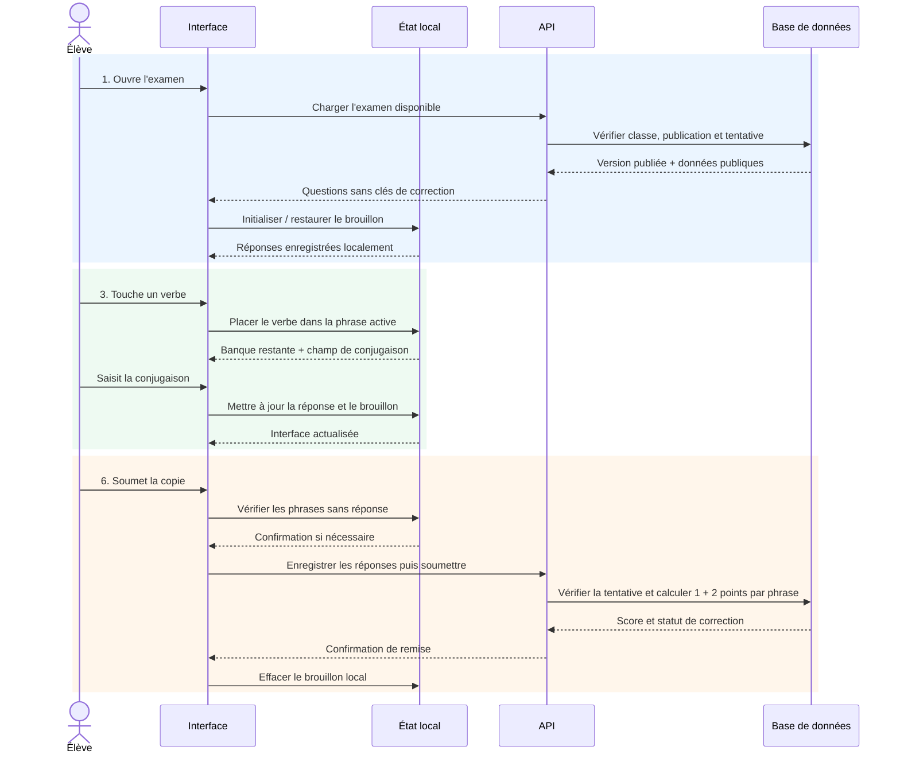

# Verbes à trous avec banque

Le type `verbes_trous` permet de compléter plusieurs phrases en plaçant un verbe unique depuis une banque, puis en saisissant sa conjugaison.

## Création dans l'éditeur

Dans l'éditeur d'un quiz ou d'un examen, ajouter **Verbes à trous avec banque**, puis renseigner :

- le titre et la consigne ;
- la banque (un verbe par ligne, verbes pièges autorisés) ;
- pour chaque phrase : début, fin, verbe attendu et une ou plusieurs conjugaisons acceptées.

Règles de validation : au moins une phrase, banque de taille supérieure ou égale au nombre de phrases, aucun doublon dans la banque, aucun verbe attendu répété, chaque verbe attendu présent dans la banque et au moins une réponse acceptée par phrase. Le barème est calculé à 3 points par phrase.

## Format JSON d'un quiz

```json
{
  "type": "verbes_trous",
  "question": "Esercizio 6 – Verbi riflessivi e presente indicativo",
  "points": 6,
  "verbes_trous": {
    "titre": "Esercizio 6 – Verbi riflessivi e presente indicativo",
    "consigne": "Choisissez le verbe qui convient, puis conjuguez-le au présent.",
    "points_par_phrase": 3,
    "banque": ["addormentarsi", "divertirsi", "chiamarsi", "bere", "dire", "venire"],
    "phrases": [
      {
        "id": 1,
        "debut": "Quando sono molto stanco, io ",
        "fin": " subito.",
        "verbe": "addormentarsi",
        "reponses": ["mi addormento"]
      },
      {
        "id": 2,
        "debut": "Noi ",
        "fin": " troppo caffè.",
        "verbe": "bere",
        "reponses": ["beviamo"]
      }
    ]
  }
}
```

Le total `points` vaut ici 6 pour les deux phrases. Les réponses sont comparées sans tenir compte de la casse ni des espaces superflus ; les accents restent significatifs.

## Format JSON d'un examen composite

Dans `sections[].questions[]`, utiliser :

- `type: "verbes_trous"`
- `prompt` : titre de la question affiché dans l'examen ;
- `points` : nombre de phrases × 3 ;
- `verbes_trous` : les champs publics `titre`, `consigne`, `points_par_phrase`, `banque`, et `phrases` avec `id`, `debut`, `fin` ;
- `answer_key.phrases` : les objets `id`, `verbe`, `reponses` attendus.

Les données envoyées à l'élève ne contiennent jamais `answer_key`. La migration stocke les données de présentation dans `written_exam_questions.public_data` et le corrigé dans `written_exam_answer_keys`. La correction des examens est calculée côté base à la soumission. Les quiz publics calculent leur note côté client et ne créent pas de tentative d'examen.

## Barème

Chaque phrase vaut 3 points : 1 point pour le verbe attendu placé et 2 points si la conjugaison correspond à l'une des réponses acceptées. Une phrase sans verbe placé vaut 0. Les verbes inutilisés ne rapportent aucun point.

## Séquence — ouverture, placement et soumission



## Tests

```bash
npm test
npm run lint
npm run build
```

Les tests unitaires de `src/utils/verbesTrous.test.ts` couvrent la normalisation, les accents, les verbes uniques, les phrases vides, les réponses alternatives, la banque avec pièges et la notation partielle.
