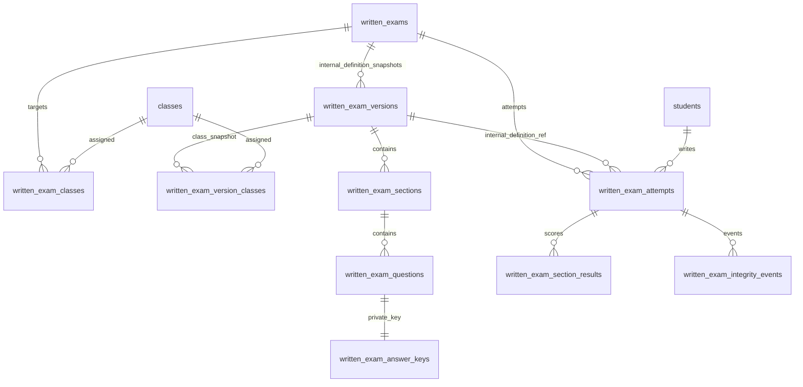

# Base de données – Examens écrits composites

Cette fonctionnalité possède son propre modèle PostgreSQL. Elle ne réutilise ni ne modifie `exams`, `exam_rubrics`, `evaluations`, `exam_pass_order`, `quizzes` ou `quiz_submissions`. Les deux canevas JSON A1 et L135 sont des modèles statiques fournis par l’application : ils ne sont pas des examens et ne créent aucune ligne en base. Un professeur peut créer directement un examen conforme à l’un de ces formats, ou démarrer depuis un canevas.

## Modèle relationnel

| Table | Rôle |
|---|---|
| `written_exams` | Identité, titre, langues, classe(s) courantes, état, dates, politique de tentatives et paramètres de publication |
| `written_exam_classes` | Classes ciblées par la définition courante |
| `written_exam_version_classes` | Instantané des classes autorisées pour la définition courante, conservé pour compatibilité des RPC et des tentatives historiques |
| `written_exam_versions` | Ligne technique de définition courante (une seule ligne active par examen). Le nom historique de la table est conservé pour compatibilité SQL, mais l’application ne propose ni ne crée de versions métier. Une seule ligne est active (brouillon ou publiée) à la fois ; les anciennes lignes sont archivées pour conserver les tentatives historiques déjà liées à elles. |
| `written_exam_sections` | Rubriques dynamiques, ordre, plafond, catégorie et groupe libres, consignes, texte-support partagé et lien vers document PDF/image (`support_url`) |
| `written_exam_questions` | Questions figées, type, énoncé, barème, options/éléments publics, référence au quiz source et indicateur de correction manuelle |
| `written_exam_answer_keys` | Clés privées et explications; jamais retournées par les RPC de passage |
| `written_exam_attempts` | Une ligne par tentative : élève, référence technique vers la définition utilisée, échéance serveur, permutation, réponses, scores, note d’expression écrite, état de publication et indicateur de disqualification anti-triche |
| `written_exam_section_results` | Détail des points par section; ces lignes ne deviennent pas des évaluations/quiz séparés |
| `written_exam_integrity_events` | Événements de visibilité/focus/plein écran horodatés, dont les violations entraînant une note nulle |

## Cycle de vie

1. Le professeur crée un examen directement ou depuis l’un des deux canevas JSON. `save_written_exam_definition` crée une seule ligne de définition pour cet examen. Les sauvegardes suivantes réutilisent cette même ligne, recalculent le maximum brut et remplacent le contenu tant qu’aucune tentative n’existe.
2. `publish_written_exam` valide les sections, plafonds, types et clés, puis publie l’examen. Dès qu’une tentative est créée, le contenu et les classes de l’examen sont verrouillés afin de préserver les copies et les corrections. Pour proposer un autre sujet après le début des tentatives, le professeur crée un nouvel examen ; le sujet commencé n’est plus éditable.
3. `list_available_written_exams` n'expose que les métadonnées et examens destinés à la classe de l'élève connecté.
4. `start_written_exam` retrouve l'élève à partir de l'e-mail de la session Supabase, contrôle sa classe et la période, crée une tentative unique et calcule l'échéance avec l'heure PostgreSQL. Il génère et stocke une permutation par tentative; les sections d'un même `group_name` restent ensemble et l'ordre est conservé à la reprise.
5. `save_written_exam_answers` n'accepte que des identifiants de questions appartenant à la définition de l’examen utilisée par la tentative. La sauvegarde n'accepte ni score ni identité du navigateur.
6. `submit_written_exam` verrouille la tentative, calcule les points QCM, réponses courtes/multi-trous et réordonnancement côté PostgreSQL, puis produit le détail par section. Les questions marquées pour revue manuelle mettent la tentative en attente de correction.
7. `grade_written_exam_attempt` valide les notes manuelles contre les plafonds et calcule le score final.
8. `publish_written_exam_results` rend les notes accessibles. `get_my_written_exam_corrections` ne renvoie les clés et explications qu'après publication des résultats et si le professeur a activé cette option. Une tentative signalée pour changement d’onglet/fenêtre est soumise automatiquement et conserve un résultat nul, même si une correction manuelle est ensuite tentée.

## Sécurité

- Toutes les tables ont RLS activé. La politique directe autorise uniquement le compte enseignant reconnu par `written_exam_is_teacher()` (adresse administrateur de l'application).
- Les élèves n'ont aucun accès direct aux tables d'examens, de clés, de tentatives ou de résultats. Leur parcours passe par des fonctions `SECURITY DEFINER` qui identifient la session via `auth.jwt()`.
- Les clés de réponse et explications sont conservées dans `written_exam_answer_keys`. Les RPC de démarrage et de liste ne les sélectionnent pas.
- Les notes et le statut de la tentative sont calculés par le serveur. Une soumission répétée, une tentative expirée, une classe non autorisée, un examen fermé ou un identifiant de question étranger sont refusés.
- Le RPC `flag_written_exam_integrity_violation` enregistre côté serveur les changements d’onglet/fenêtre et les tentatives de capture clavier détectables. Un trigger impose alors un score final nul, y compris après une correction manuelle ou la saisie de l’expression écrite. Le navigateur ne fournit pas de signal fiable pour les captures natives iOS.
- Un examen qui possède au moins une tentative est verrouillé au niveau SQL : sections, questions, corrigés, paramètres et classes ne peuvent plus être modifiés. Cela protège les réponses et résultats historiques. Un nouveau sujet doit être créé comme un nouvel examen.

## Installation Supabase

Dans le SQL Editor du projet Supabase utilisé par PerckyLingua, exécuter les migrations dans cet ordre, une seule fois chacune :

1. `supabase/migrations/20261108000000_composite_written_exams.sql` — schéma des examens écrits composites.
2. `supabase/migrations/20261109000000_verbes_trous_written_exams.sql` — type de question « verbes à trous avec banque » et notation serveur.
3. `supabase/migrations/20261110000000_written_exam_question_timers.sql` — limites de temps par question et chronomètre serveur.
4. `supabase/migrations/20261111000000_fix_written_exam_time_limit_count.sql` — correction de compatibilité PostgreSQL du RPC de sauvegarde des temps par question. **Indispensable si la migration précédente est déjà installée** : elle remplace l'appel invalide à `jsonb_object_length(jsonb)`.
5. `supabase/migrations/20261112000000_reset_written_exam_attempts.sql` — réinitialisation sécurisée des tentatives d'un examen clôturé.
6. `supabase/migrations/20261113000000_clarify_existing_draft_exam_prompts.sql` — consignes détaillées des sujets en brouillon.
7. `supabase/migrations/20261114000000_include_manual_review_in_student_corrections.sql` — champ de correction manuelle dans la copie détaillée.
8. `supabase/migrations/20261115000000_manual_written_expression_score.sql` — note d'expression écrite sur 10 ou 20 intégrée au total sur 100.
9. `supabase/migrations/20261116000000_written_exam_integrity_disqualification.sql` — disqualification serveur et note nulle après violation d’intégrité.
10. `supabase/migrations/20261117000000_hybrid_written_exam_grading.sql` — correction automatique préalable, validation/surcharge manuelle et conservation de la note d’expression écrite même si la tentative est disqualifiée.
11. `supabase/migrations/20261118000000_enable_published_student_exam_copies.sql` — expose les copies détaillées après publication des résultats.
12. `supabase/migrations/20261119000000_single_definition_written_exams.sql` — impose une seule définition active par examen, réutilise la même ligne lors des sauvegardes et verrouille les examens dès qu’une tentative existe.

Après application, vérifier la création des tables `written_*`, les fonctions RPC et les politiques RLS. Tester avec un compte enseignant et deux comptes élèves appartenant à des classes différentes. Vérifier qu'un élève ne peut ni sélectionner directement `written_exam_answer_keys`, ni appeler une tentative pour une autre classe. Effectuer les tests de publication, reprise, expiration, double soumission, correction manuelle et publication des résultats avant de faire passer un examen réel.

**Ne pas exécuter** le schéma d'initialisation historique `src/data/supabaseSqlSchema.ts` pour cette fonctionnalité : il contient des suppressions de tables existantes et des politiques permissives. La migration écrite est additive et isolée.

## Limites connues

- Le navigateur ne peut pas bloquer ou détecter de manière fiable une capture d'écran système ou une photo prise avec un autre appareil.
- Les réponses courtes automatiques reposent sur des variantes exactes normalisées; les réponses ambiguës doivent être revues par le professeur.
- Les règles RLS et RPC doivent être validées dans le projet Supabase cible avant production. Aucun accès au projet Supabase de production ni exécution de migration distante n'est effectué par cette PR.

## Note manuelle d’expression écrite

- Dans l’éditeur, choisir aucune note, une note sur 10 ou une note sur 20. Les modèles A1 et L135 sont préconfigurés respectivement sur 20 et 10 points afin que les autres questions complètent le total à 100.
- La configuration est enregistrée sur l’examen brouillon et figée dès la première tentative. Elle ne modifie pas les examens publiés ni les tentatives existantes.
- Après correction de la copie, le professeur saisit la note d’expression écrite. La base valide le plafond, ajoute la note au score automatique et aux éventuelles corrections manuelles, puis recalcule le résultat sur 100.
- La publication des résultats est refusée tant que la note d’expression écrite requise n’a pas été saisie.

## Interface immersive et navigation

- Au démarrage d’une tentative, l’espace étudiant masque l’en-tête, le bandeau de bienvenue, les onglets et le pied de page PerckyLingua. L’interface de l’examen occupe tout l’écran, y compris sur Safari iOS où l’API native Fullscreen n’est pas disponible.
- Chaque question possède un bouton de validation qui sauvegarde la réponse avant de passer à la suivante. Les flèches gauche/droite et la touche Entrée déclenchent la navigation; le chronomètre global reste la limite absolue de la tentative.

## Correction hybride, filtres et copie PDF

- Les réponses objectives et textuelles sont toujours corrigées automatiquement à la remise. Les questions marquées `manual_review` conservent cette proposition automatique et passent ensuite dans la file de vérification du professeur.
- Pour chaque question, l'enseignant voit la réponse originale en lecture seule et la proposition automatique. Il peut confirmer ou remplacer uniquement la note, y compris pour les QCM, les réponses à compléter, les verbes à trous et les réponses longues. La note manuelle remplace le score automatique de la question; elle ne s'y additionne jamais. Une nouvelle sauvegarde reste idempotente. La réponse de l'élève n'est jamais modifiable depuis l'interface de correction.
- Les réponses textuelles de compréhension et les réponses à compléter reçoivent une proposition automatique lorsqu'une clé de correction est fournie. Le professeur peut ajuster uniquement les points si une formulation équivalente ou une réponse correcte a été refusée par le système.
- Après une violation d'intégrité, le résultat global de l'examen reste nul. Le professeur peut néanmoins enregistrer séparément la note d'expression écrite; cette note est conservée dans le dossier pédagogique, sans modifier la note finale disqualifiée.
- L'espace professeur propose une recherche par nom, prénom, matricule ou identifiant, ainsi que des filtres combinables par statut, intégrité et intervalle de notes.
- Après publication des résultats et des corrigés, l'élève peut télécharger sa feuille de copie corrigée au format PDF depuis l'espace étudiant. Le PDF contient les réponses fournies, les réponses attendues, le statut de correction et les points attribués.
- Sur iPhone/iPad et autres mobiles, un événement `visibilitychange` (changement d'application, écran verrouillé ou interruption iOS) est journalisé sans avertissement bloquant, sans remise automatique et sans disqualification. Une capture d'écran native n'est pas détectable de façon fiable depuis Safari et n'est jamais considérée comme une preuve de fraude. La perte de focus/changement d'onglet reste disqualifiante uniquement sur ordinateur après le délai de tolérance.
- Les tests automatisés simulent la politique mobile et vérifient que les événements mobiles/screenshot ne modifient pas `integrity_failed`; ils conservent un test de disqualification pour une perte de focus sur ordinateur. Une validation manuelle sur un iPhone physique reste nécessaire avant production.
- Les canevas A1 et L135 réservent 50 secondes par QCM et 90 secondes par réponse saisie en compréhension écrite. Une marge de lecture de 60 secondes (A1) ou 90 secondes (B1) est ajoutée à la première question de la section. Les durées globales passent respectivement à 80 et 105 minutes.
