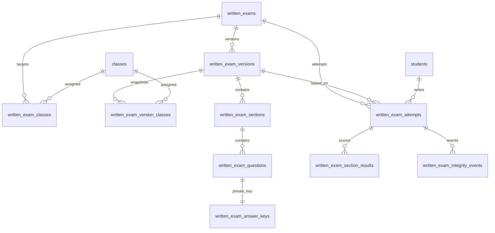

# Base de données – Examens écrits composites

Cette fonctionnalité possède son propre modèle PostgreSQL. Elle ne réutilise ni ne modifie `exams`, `exam_rubrics`, `evaluations`, `exam_pass_order`, `quizzes` ou `quiz_submissions`.

## Modèle relationnel

| Table | Rôle |
|---|---|
| `written_exams` | Identité, titre, langues, classe(s) courantes, état, dates, politique de tentatives et paramètres de publication |
| `written_exam_classes` | Classes ciblées par la définition courante |
| `written_exam_version_classes` | Instantané des classes autorisées par version publiée |
| `written_exam_versions` | Instantané versionné et immuable après publication : durée, dates, échelle, mélange, total brut et paramètres d'intégrité |
| `written_exam_version_classes` | Copie des classes ciblées au moment de la sauvegarde de chaque version |
| `written_exam_sections` | Rubriques dynamiques, ordre, plafond, catégorie et groupe libres, consignes, texte-support partagé et lien vers document PDF/image (`support_url`) |
| `written_exam_questions` | Questions figées, type, énoncé, barème, options/éléments publics, référence au quiz source et indicateur de correction manuelle |
| `written_exam_answer_keys` | Clés privées et explications; jamais retournées par les RPC de passage |
| `written_exam_attempts` | Une ligne par tentative composite : élève, version, échéance serveur, permutation, réponses, score automatique et manuel, état de publication |
| `written_exam_section_results` | Détail des points par section; ces lignes ne deviennent pas des évaluations/quiz séparés |
| `written_exam_integrity_events` | Événements de visibilité/focus/plein écran horodatés, à interpréter comme signaux |

## Cycle de vie

1. Le professeur enregistre un brouillon via `save_written_exam_definition`. La fonction écrit la définition et ses clés dans des tables séparées, calcule le maximum brut et copie les classes dans `written_exam_version_classes`.
2. `publish_written_exam` valide les sections, plafonds, types et clés, puis publie la version. Les triggers interdisent ensuite la modification des questions, sections, clés, classes et paramètres de cette version. Une édition crée une nouvelle version.
3. `list_available_written_exams` n'expose que les métadonnées et examens destinés à la classe de l'élève connecté.
4. `start_written_exam` retrouve l'élève à partir de l'e-mail de la session Supabase, contrôle sa classe et la période, crée une tentative unique et calcule l'échéance avec l'heure PostgreSQL. Il génère et stocke une permutation par tentative; les sections d'un même `group_name` restent ensemble et l'ordre est conservé à la reprise.
5. `save_written_exam_answers` n'accepte que des identifiants de questions appartenant à la version de la tentative. La sauvegarde n'accepte ni score ni identité du navigateur.
6. `submit_written_exam` verrouille la tentative, calcule les points QCM, réponses courtes/multi-trous et réordonnancement côté PostgreSQL, puis produit le détail par section. Les questions marquées pour revue manuelle mettent la tentative en attente de correction.
7. `grade_written_exam_attempt` valide les notes manuelles contre les plafonds et calcule le score final.
8. `publish_written_exam_results` rend les notes accessibles. `get_my_written_exam_corrections` ne renvoie les clés et explications qu'après publication des résultats et si le professeur a activé cette option.

## Sécurité

- Toutes les tables ont RLS activé. La politique directe autorise uniquement le compte enseignant reconnu par `written_exam_is_teacher()` (adresse administrateur de l'application).
- Les élèves n'ont aucun accès direct aux tables d'examens, de clés, de tentatives ou de résultats. Leur parcours passe par des fonctions `SECURITY DEFINER` qui identifient la session via `auth.jwt()`.
- Les clés de réponse et explications sont conservées dans `written_exam_answer_keys`. Les RPC de démarrage et de liste ne les sélectionnent pas.
- Les notes et le statut de la tentative sont calculés par le serveur. Une soumission répétée, une tentative expirée, une classe non autorisée, un examen fermé ou un identifiant de question étranger sont refusés.
- Le journal d'intégrité ne déclenche aucune pénalité automatique. Un changement d'onglet ou de focus est un signal contextualisé, pas une preuve de fraude.
- Les versions publiées sont immuables. Une modification de sujet doit créer une nouvelle version.

## Installation Supabase

1. Ouvrir le SQL Editor du projet Supabase utilisé par PerckyLingua.
2. Examiner puis exécuter **uniquement** `supabase/migrations/20261108000000_composite_written_exams.sql`.
3. Vérifier la création des tables `written_*`, les fonctions RPC et les politiques RLS.
4. Tester avec un compte enseignant et deux comptes élèves appartenant à des classes différentes.
5. Vérifier qu'un élève ne peut ni sélectionner directement `written_exam_answer_keys`, ni appeler une tentative pour une autre classe.
6. Effectuer les tests de publication, reprise, expiration, double soumission, correction manuelle et publication des résultats avant de faire passer un examen réel.

**Ne pas exécuter** le schéma d'initialisation historique `src/data/supabaseSqlSchema.ts` pour cette fonctionnalité : il contient des suppressions de tables existantes et des politiques permissives. La migration écrite est additive et isolée.

## Limites connues

- Le navigateur ne peut pas bloquer ou détecter de manière fiable une capture d'écran système ou une photo prise avec un autre appareil.
- Les réponses courtes automatiques reposent sur des variantes exactes normalisées; les réponses ambiguës doivent être revues par le professeur.
- Les règles RLS et RPC doivent être validées dans le projet Supabase cible avant production. Aucun accès au projet Supabase de production ni exécution de migration distante n'est effectué par cette PR.
